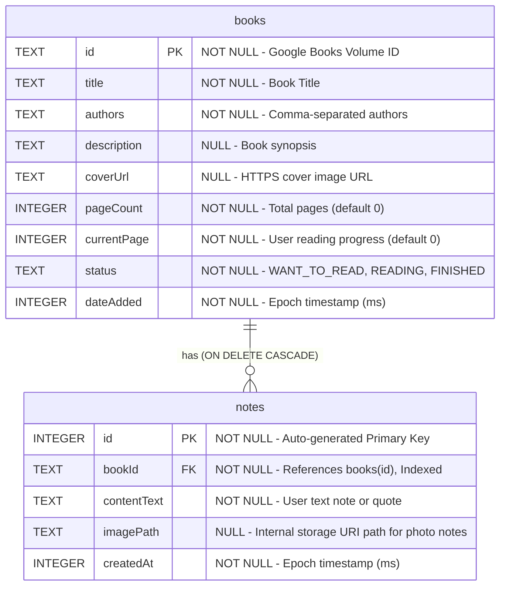

# BookStash Physical Database Schema & ER Diagram

This Entity-Relationship (ER) diagram represents the normalized SQLite database managed by Jetpack Room (`BookStashDatabase`, version 1).

## Normalization & Constraint Justification

1. **First, Second, and Third Normal Form (3NF):** Book metadata is stored once in the parent `books` table (`BookEntity`), while multiple user-generated notes and photo references are stored in the child `notes` table (`NoteEntity`), eliminating data redundancy.
2. **Referential Integrity (`ON DELETE CASCADE`):** `notes.bookId` enforces a strict Foreign Key constraint referencing `books.id` with `onDelete = ForeignKey.CASCADE`. Deleting a book automatically purges its orphaned child notes.
3. **Safe In-Place Updates (`@Upsert`):** `BookDao` uses `@Upsert` rather than `OnConflictStrategy.REPLACE` so updating a book's reading progress or status performs an in-place `UPDATE` without triggering `ON DELETE CASCADE` on child notes.
4. **Query Optimization (`@Index`):** An explicit SQLite index (`index_notes_bookId`) is applied to the foreign key column `notes.bookId` to avoid full-table scans during parent-child joins and cascading deletes.